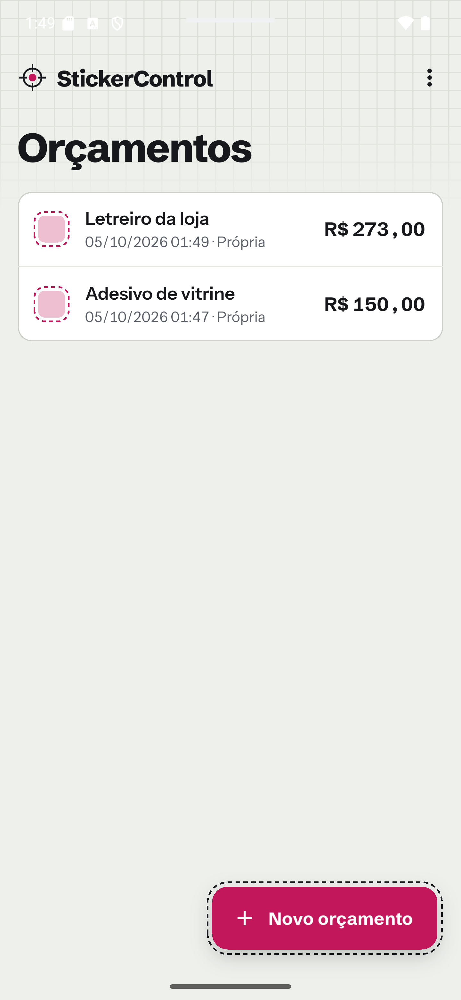
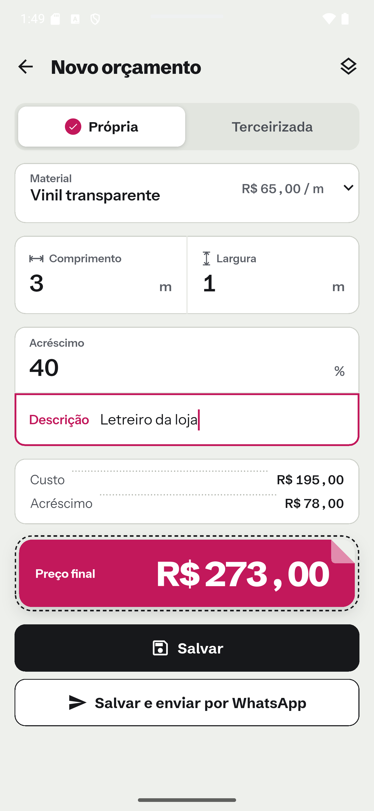
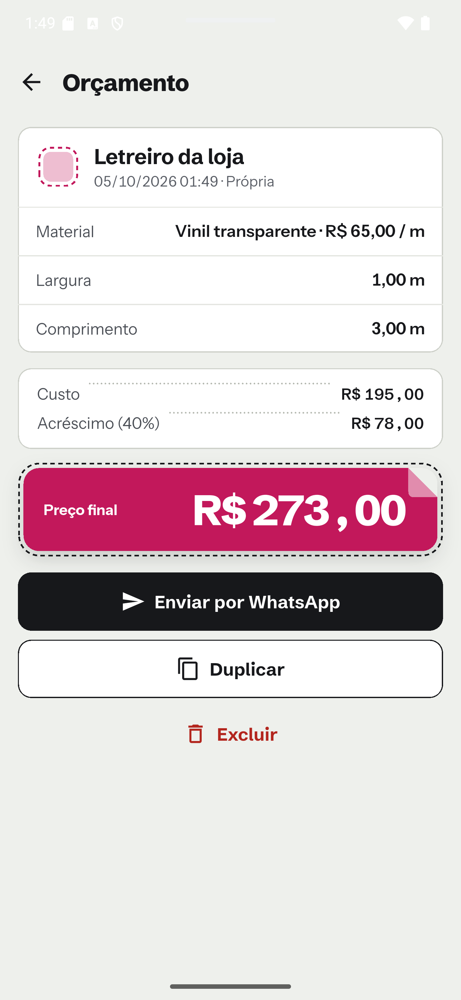
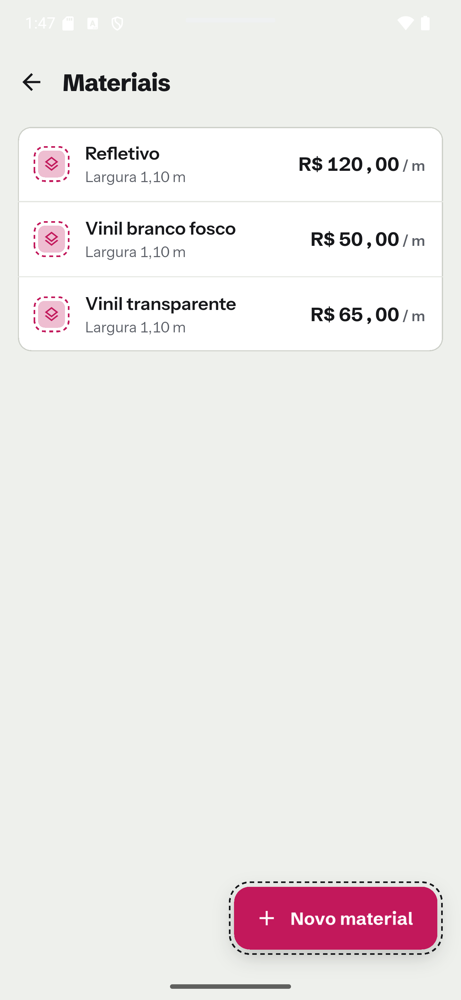

# StickerControl

App Flutter (Android) para uma pequena empresa de adesivos calcular orçamentos
no celular: material, comprimento, largura e percentual de acréscimo. Os dados
ficam só no aparelho, sem login nem servidor.

> Projeto de portfólio. Os prints usam dados fictícios.

<p>
  
  
  
  
</p>

## Funcionalidades

- Cadastro de materiais com preço por metro e largura.
- Orçamento de produção própria ou terceirizada, com preço final ao vivo.
- Histórico, detalhe, duplicar e excluir orçamentos.
- Envio por WhatsApp com mensagem em modelo editável (só o preço final, sem custo
  nem percentual).
- Nome da empresa configurável.

## Regras de cálculo

- Custo da produção própria = preço por metro × comprimento; a largura não
  altera o custo.
- Até 1,10 m de largura é produção própria; acima disso o app só avisa.
- Dinheiro em centavos inteiros, com arredondamento half-up em 2 casas.
- O orçamento salvo guarda o preço do material usado; mudar o preço depois não
  altera orçamentos antigos.

## Estrutura

- `lib/ui` — telas e widgets
- `lib/logic` — regras e cálculo de preço (funções puras)
- `lib/data` — persistência local (Drift/SQLite)
- `design` — identidade visual "Recorte"

## Rodando

O código gerado pelo Drift (`lib/data/app_database.g.dart`) não é versionado.
Gere-o depois de clonar e sempre que mudar as tabelas:

```bash
flutter pub get
dart run build_runner build --delete-conflicting-outputs
```

Depois:

```bash
flutter run
flutter test
flutter analyze
```

## Licença

[MIT](LICENSE)
